<div align="center">

<picture>
  <source media="(prefers-color-scheme: dark)" srcset=".github/assets/banner-dark.svg">
  
</picture>

**Native desktop applications written in PHP.**<br>
Components, state and styles in PHP; a Rust host that lays the tree out and drives real platform views.<br>No Electron, no Node.js, no web view in the rendering path.

[](https://packagist.org/packages/pushinbr/pam-desktop)
[](https://github.com/push-in/pam-desktop/releases/latest)

[](https://github.com/push-in/pam-desktop/actions/workflows/ci.yml)
[](LICENSE)

[Install](#install) · [Quick example](#quick-example) · [Platforms](#platform-support) · [Features](#features) · [Docs](#docs) · [Issues](https://github.com/push-in/pam-desktop/issues)

</div>

<a id="install"></a>
## <picture></picture> Install

Create a project with the PAM CLI and run it:

```sh
pam init my-app --template desktop
cd my-app
pam composer require pushinbr/pam-desktop:^2.1
pam desktop init
pam desktop dev
```

`pam init --template desktop` in CLI 2.2.11 still scaffolds `pushinbr/pam-desktop` `^1.2` (1.x), so the third line moves the project to 2.x; it becomes unnecessary once the template is updated. `pam desktop init` writes a small application: a router, a home screen as a `.pam.php` template with scoped CSS, design tokens, a service and a test. `pam desktop dev` needs no argument (it finds the nearest `pam-desktop.json`), reloads the window about 0.3 s after a save and keeps `#[State]` values. Without PHP on the machine, the host installs it (the PAM runtime on Linux and macOS, the official windows.php.net build on Windows).

`pam desktop` runs the package's launcher, which downloads the native host of the installed version for the current system from the [GitHub release](https://github.com/push-in/pam-desktop/releases/latest) (Linux, macOS and Windows, x86_64 and aarch64), verifies its SHA-256 and runs it. `PAM_DESKTOP_HOST` points the launcher at a host built from source. To build and run from a checkout, see [Examples](docs/examples.md).

> PAM Desktop 2.0 is a different product from 1.x. Version 1 rendered a web interface in a Servo web view behind a typed command gateway; version 2 renders a native interface from PHP components. Applications written for 1.x do not run on 2.x. See [Migrating from 1.x](docs/migrating-from-1.x.md).

<a id="quick-example"></a>
## <picture></picture> Quick example

`examples/counter/index.php`:

```php
<?php

declare(strict_types=1);

use Pam\Desktop\App;
use Pam\Desktop\Component;
use Pam\Desktop\Attributes\State;
use Pam\Desktop\Style;
use Pam\Desktop\UI\Button;
use Pam\Desktop\UI\Column;
use Pam\Desktop\UI\Text;

require __DIR__.'/../../vendor/autoload.php';

final class Counter extends Component
{
    #[State]
    public int $count = 0;

    public function render(): Column
    {
        return Column::make(
            Text::make('PAM Desktop')->style(new Style(fontSize: 28, fontWeight: 700)),
            Text::make("Count: {$this->count}")->style(new Style(fontSize: 18)),
            Button::make('Increment')->onPress(function (): void {
                $this->count++;
            }),
        )->style(new Style(padding: 24, gap: 16));
    }
}

App::run(new Counter());
```

Assigning to a `#[State]` property schedules a render. The host receives a patch with the one text that changed.

<a id="platform-support"></a>
## <picture></picture> Platform support

| Platform | Support | Notes |
| --- | --- | --- |
| Linux | GTK 4 (`pam-desktop-gtk`) | The reference backend. Every example and every feature was run and checked on Linux. |
| macOS | AppKit (`pam-desktop-appkit`) | Run on macOS 26 (x86_64) in a VM without a GPU: core examples, hot reload, input, a real application and a DMG from `pam-desktop build`. Not run on Apple Silicon; blur, media, web views, notifications, printing and drag and drop not verified. |
| Windows | Win32 + Direct2D/DirectWrite (`pam-desktop-win32`) | Type-checked by cross compilation against the same `Backend` contract. Not run on Windows yet: first runs are expected to need fixes. |

<a id="requirements"></a>
## <picture></picture> Requirements

| Requirement | Notes |
| --- | --- |
| PHP 8.5 | The `php` executable on `PATH`, or `pam` (the host then runs `pam exec`), or the path in `PAM_DESKTOP_PHP`. On Linux and macOS without any of them, the host installs the PAM runtime, which embeds PHP; on Windows it downloads the official PHP 8.5 build from windows.php.net (not run on Windows yet). |
| Composer | To install the `pushinbr/pam-desktop` package. |
| Linux, to run a released host | glibc 2.35 or newer, GTK 4.6 or newer and the GStreamer plugins for media (Ubuntu 22.04, Debian 12, Fedora 36 and later). WebKitGTK 6 (`libwebkitgtk-6.0-4`, Ubuntu 24.04 and later) only for applications that show a `WebView`. The released host is built on Ubuntu 22.04 and uses the GTK features newer than 4.6 when the installed GTK has them. |
| Rust 1.92 or newer | Only to build the host from a checkout. `rust-toolchain.toml` selects the stable channel. |
| Linux, to build: `libgtk-4-dev` | GTK 4.6 or newer. |

The optional features of the host on Linux, `tray` and `hotkeys`, need no extra system library. [Platforms](docs/platforms.md) lists what each feature does.

The host starts the backend of the system it was built for. Two things were not verified on Linux either: the accessibility tree with a real screen reader, and global shortcuts through the Wayland portal (X11 key grabs were verified). Per-feature status: [Platforms](docs/platforms.md); first-run checklist: [First run on macOS and Windows](docs/first-run-macos-windows.md).

<a id="how-it-works"></a>
## <picture></picture> How it works

A PAM Desktop application is a PHP script. It declares components with reactive state and returns a tree of elements (`Column`, `Row`, `Text`, `Button`, `Input`, `VirtualizedList`…), using the same component syntax as PAM Native, the mobile sibling of this project.

The `pam-desktop` host starts that script in a PHP worker process and talks to it over stdin and stdout in binary frames. For every frame the host lays the tree out, computes the difference from the previous one and updates real platform views:

- GTK 4 on Linux
- AppKit on macOS
- Win32 with Direct2D and DirectWrite on Windows

Rendering never goes through a web view. A `WebView` element exists for the cases where an application wants to embed a page.

The host does not wait for PHP to animate, scroll, track gestures, play media or edit text. PHP runs when an event needs application logic and sleeps otherwise.

<a id="features"></a>
## <picture></picture> Features

| Area | What you get | Document |
| --- | --- | --- |
| Components | Layout, text with inline boxes, buttons, inputs (masks, currency, decimal), switches, content-sized lists, scroll views, modals with backdrop blur, bottom sheets, stack navigation with a header, tabs | [Components](docs/components.md) |
| Templates | `.pam.php` single-file components: expressions with enums, constants and value methods, `<Slot :content>`, per-component error isolation | [Templates](docs/templates.md) |
| Styling | `Style` and scoped CSS laid out like Chromium (1/64 px LayoutUnits, Blink line heights): state selectors with `:focus-within` and `:focus-visible`, `@media`, CSS tables, inline formatting (`inline`, `inline-block`, `vertical-align`), `position: sticky`, two-axis scrolling, classic and thin scrollbars with `scrollbar-color`, `ch` units, form controls sized like Blink, font stacks and packaged fonts, line breaking, `white-space`, `backdrop-filter` and box shadows matching Skia, fractional grid tracks, dark mode, text scale | [Styling](docs/styling.md), [Grid tracks](docs/grid-tracks.md) |
| Controls | Select, Autocomplete, MultiSelect, DatePicker, Toast and the window toast service, Checkbox, ProgressButton (`pushinbr/pam-desktop-ui`) | [DesktopUI](docs/desktop-ui.md) |
| Internationalization | Framework defaults in English, Portuguese and Spanish, following the system or `I18n::use()`, overridable per app and per component | [Internationalization](docs/i18n.md) |
| Charts | Line, area, bar, donut, sparkline, progress ring on the native canvas (`pushinbr/pam-desktop-charts`) | [Charts](docs/charts.md) |
| Desktop shell | Main window control, secondary windows, menu bar, context menus, tray, local and global shortcuts, key capture, file dialogs, notifications, typed drag and drop, clipboard | [Desktop shell](docs/desktop-shell.md) |
| Media and web | Images with a disk cache, video and audio, embedded web pages, vector and freehand canvases | [Media and web](docs/media-and-web.md) |
| Motion | Transitions, presets, animation programs, gesture detectors, drag contracts, swipeable rows, native pan and zoom | [Animation and gestures](docs/animation-and-gestures.md) |
| Modules | Key/value storage, file sandbox and save dialog, HTTP, WebSocket, SQLite with guarded transactions, secure storage, printing, timers, device information and status, links and deep links with a single instance, toasts, alerts | [Modules](docs/modules.md) |
| Accessibility | Roles, labels, states and actions mapped to AT-SPI, NSAccessibility and UI Automation; announcements; text selection; keyboard navigation | [Accessibility](docs/accessibility.md) |
| Development | Hot reload with state preservation, the error overlay, `pam-desktop check` (every template/CSS diagnostic without a window), frame dumps compared with Chromium, screenshots on a virtual display, test suites, static analysis, CI | [Development](docs/development.md) |
| Internals | Processes, the frame protocol, the render core, the `Backend` contract, threading | [Architecture](docs/architecture.md) |
| Compatibility | Host and SDK versions, the property table and what an older host refuses | [Compatibility](docs/compatibility.md) |
| Shipping | Packaging and installers | [Distribution](docs/distribution.md) |
| Updates | Application updates | [Updates](docs/updates.md) |

Capabilities that only exist on phones in PAM Native (location, contacts, sensors, biometrics, SMS…) are not part of PAM Desktop. Their class names are still known: using one throws a `PluginException` that names the optional package it belongs to.

<a id="examples"></a>
## <picture></picture> Examples

Every directory under [`examples/`](examples) is a runnable application that exercises one feature: `counter`, `showcase`, `controls`, `lists`, `chat`, `navigation`, `motion`, `gestures`, `images`, `media`, `webview`, `canvas`, `shell`, `windows`, `dragdrop`, `text`, `modules`, `links`, `toast`, `errors`, `web-defaults`. What each one shows and how to run them from a checkout: [docs/examples.md](docs/examples.md). Crate and package map: [docs/repository-layout.md](docs/repository-layout.md).

<a id="docs"></a>
## <picture></picture> Docs

- [Getting started](docs/getting-started.md)
- [Components](docs/components.md)
- [Templates](docs/templates.md)
- [Styling](docs/styling.md)
- [Grid tracks](docs/grid-tracks.md)
- [DesktopUI](docs/desktop-ui.md)
- [Charts](docs/charts.md)
- [Desktop shell](docs/desktop-shell.md)
- [Media and web](docs/media-and-web.md)
- [Animation and gestures](docs/animation-and-gestures.md)
- [Modules](docs/modules.md)
- [Accessibility](docs/accessibility.md)
- [Development](docs/development.md)
- [Architecture](docs/architecture.md)
- [Compatibility](docs/compatibility.md)
- [Platforms](docs/platforms.md)
- [First run on macOS and Windows](docs/first-run-macos-windows.md)
- [Distribution](docs/distribution.md)
- [Updates](docs/updates.md)
- [Migrating from 1.x](docs/migrating-from-1.x.md)
- [Examples](docs/examples.md)
- [Repository layout](docs/repository-layout.md)
- [Changelog](CHANGELOG.md)

<a id="pam-ecosystem"></a>
## <picture></picture> Part of the PAM ecosystem

<p align="center"><picture>
  <source media="(prefers-color-scheme: dark)" srcset=".github/assets/pam-wordmark-dark.svg">
  
</picture></p>

PAM runs PHP natively on servers, desktops and phones. This repository is one piece of it.

| [**PAM**](https://github.com/push-in/pam) | [**PAM Native**](https://github.com/push-in/pam-native) | [**Ecosystem**](https://github.com/push-in/pam#ecosystem) |
| --- | --- | --- |
| the runtime and CLI | native Android and iOS apps in PHP | every official package and plugin |

<sub>Docs: [push-in.github.io/pam-docs](https://push-in.github.io/pam-docs/introduction/) · [Issues](https://github.com/push-in/pam-desktop/issues)</sub>

<p align="center"><sub><a href="LICENSE">MIT License</a>. The reactive PHP component core, the binary wire protocol and the layout and diff engine started as a copy of <a href="https://github.com/push-in/pam-native">PAM Native</a> and remain under the Apache License 2.0; <a href="NOTICE">NOTICE</a> lists the origin release and the directories that hold the copied code. The two projects do not depend on each other; fixes are ported between them by hand.<br>Made in Brazil by Pushin</sub></p>
