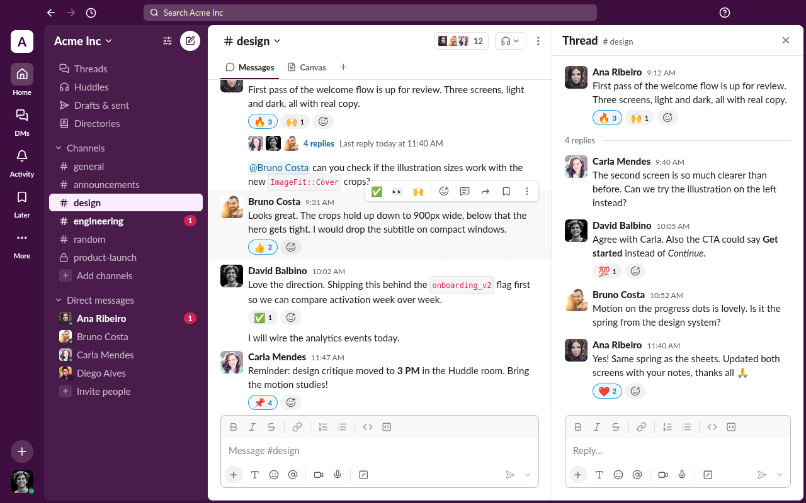

# Slack

A Slack desktop clone built only with PAM and PAM Desktop: no web view, no
JavaScript, every pixel a native view.



```bash
pam composer install
pam desktop dev
```

## What it shows

- **Workspace chrome**: the Aubergine theme, the rail, the sidebar with
  channels, DMs, unread badges and presence.
- **Messages**: Slack's mrkdwn (`*bold*`, `_italic_`, `` `code` ``, links,
  @mentions, your own mentions highlighted), grouping of consecutive messages,
  day dividers and the conversation intro, in an inverted `VirtualizedList`.
- **Reactions and hover actions**: reaction chips that toggle, and the
  message toolbar revealed by `.message:hover .actions` with no PHP round trip.
- **Threads**: the reply count with its avatars opens the thread pane beside
  the channel, with its own composer.
- **Search**: channels, people and messages as you type, matches marked;
  Enter opens the first result, Escape or a click outside closes it.
- **Composer**: formatting toolbar, multiline input, Enter to send and the
  send button that turns green when there is something to send.

Icons are the Lucide set bundled with PAM Desktop (`font="Lucide"`); the Lato
font and the avatars are packaged under `assets/`.

## Layout

| Path | What goes there |
| --- | --- |
| `src/Screens/Client` | The client window: rail, frame, channel column. |
| `src/Components` | `Sidebar`, `MessageRow`, `Composer`, `ThreadPane`, `SearchBar`. |
| `src/Domain` | Members, conversations, messages, mrkdwn runs, timeline entries, search hits. |
| `src/Services` | `Workspace` (the in-memory workspace) and `Seed` (its conversations). |
| `src/app.css` | Fonts and the theme tokens. |
| `tests/SlackTest.php` | `pam composer test`: domain rules and the mounted screen. |

| Task | Command |
| --- | --- |
| Check every template, stylesheet and route | `pam desktop check` |
| Run the tests | `pam composer test` |
| Time an interaction | `PAM_DESKTOP_PROFILE=1 pam desktop dev` |

Avatars: [pravatar.cc](https://pravatar.cc). Lato: SIL Open Font License
(`assets/fonts/OFL.txt`).
