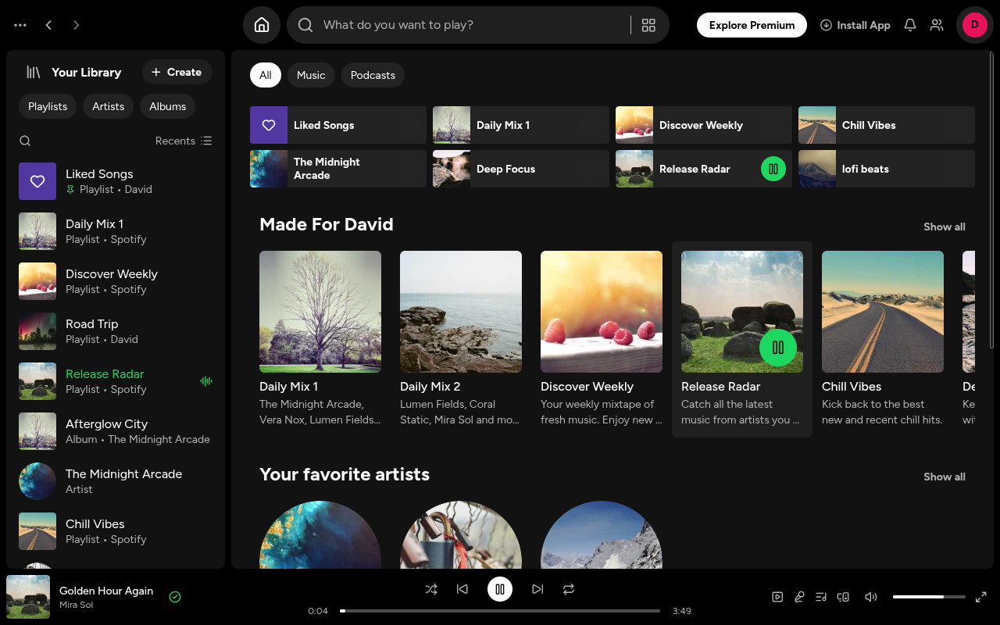

# Spotify

A Spotify desktop clone built only with PAM and PAM Desktop: no web view, no
JavaScript, every pixel a native view.



```bash
pam composer install
pam desktop dev
```

## What it shows

- **The three panels**: Your Library with filters, pinned items and what plays,
  the main view, and the now-playing bar.
- **Home**: quick picks and shelves whose green play buttons rise on hover
  (`.card:hover .card-play`), with no PHP round trip.
- **Playlists, albums and artists**: the tinted header, the action row and the
  track list where the number turns into a play button on hover; double-click
  or the button plays a track, the current one turns green.
- **The player**: play, pause, next, previous, shuffle, repeat (all, one), likes,
  and DesktopUI `Slider`s for the position (seeks on release) and the volume.
  The position comes from the clock: the bar ticks once a second only while
  something plays and the window is visible.
- **Search**: Browse all, then the top result and songs as you type.

Icons are the Lucide set bundled with PAM Desktop (`font="Lucide"`); Figtree
and the covers are packaged under `assets/`. Artists and songs are fictional.

## Layout

| Path | What goes there |
| --- | --- |
| `src/Screens/Player` | The window: top bar, panels, the views it switches between. |
| `src/Components` | `LibraryPanel`, `HomeView`, `PlaylistView`, `SearchView`, `NowPlayingBar`. |
| `src/Domain` | Tracks, playlists and their kinds. |
| `src/Services` | `Library` (the catalogue) and `Player` (queue, clock, modes, likes, volume). |
| `src/app.css` | Fonts and the theme tokens. |
| `tests/SpotifyTest.php` | `pam composer test`: the player on a test clock and the mounted screen. |

| Task | Command |
| --- | --- |
| Check every template, stylesheet and route | `pam desktop check` |
| Run the tests | `pam composer test` |

Figtree: SIL Open Font License (`assets/fonts/OFL.txt`). Covers:
[picsum.photos](https://picsum.photos) (Unsplash licence).
