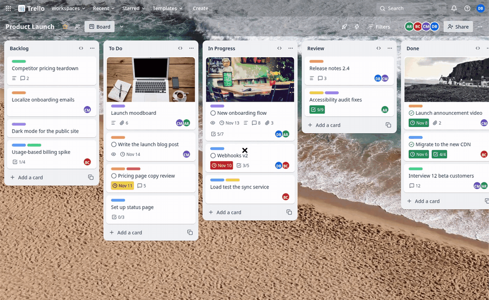

# Trello

A Trello board clone built only with PAM and PAM Desktop: no web view, no
JavaScript, every pixel a native view.



```bash
pam composer install
pam desktop dev
```

## What it shows

- **The board**: a photo background under translucent bars, lists that grow
  with their cards up to the window (a content-sized `VirtualizedList`) and
  scroll sideways.
- **Cards**: label bars, covers, the due badge in its state colour (due soon,
  overdue, complete), description, comments, attachments, checklist and member
  badges, the edit pencil on hover.
- **Drag and drop**: `DragSource` cards dropped on a card (it lands before
  it) or on a list (it lands at the end), with the gap where it will land and
  the dragged card faded.
- **Adding cards**: the inline composer; Enter adds and keeps it open,
  Escape closes it.
- **Card detail**: a `Modal` with the cover, members, labels, watching, the due
  date you can complete, description, checklist progress and the actions.
- **Kept on disk**: the board is saved in SQLite (`board.db`), its schema
  versioned with `Migrations`; cards you add or move are there after a
  restart. A context menu on every card moves it to another list, and the
  app icon counts the overdue cards.

Icons are the Lucide set bundled with PAM Desktop (`font="Lucide"`); Noto Sans
(Latin subset), the background and the covers are packaged under `assets/`.

## Layout

| Path | What goes there |
| --- | --- |
| `src/Screens/Board` | The window: app bar, board bar, the lists and the drag state. |
| `src/Components` | `ListColumn`, `CardTile`, `CardDetail`. |
| `src/Domain` | Cards, lists, labels, members. |
| `src/Services/Board.php` | The board: lists, cards, moving, adding, completing. |
| `src/app.css` | Fonts and the theme tokens. |
| `tests/TrelloTest.php` | `pam composer test`: moves, adds, due states and the mounted screen. |

| Task | Command |
| --- | --- |
| Check every template, stylesheet and route | `pam desktop check` |
| Run the tests | `pam composer test` |

Noto Sans: SIL Open Font License (`assets/fonts/OFL.txt`). Photos:
[picsum.photos](https://picsum.photos) (Unsplash licence).
