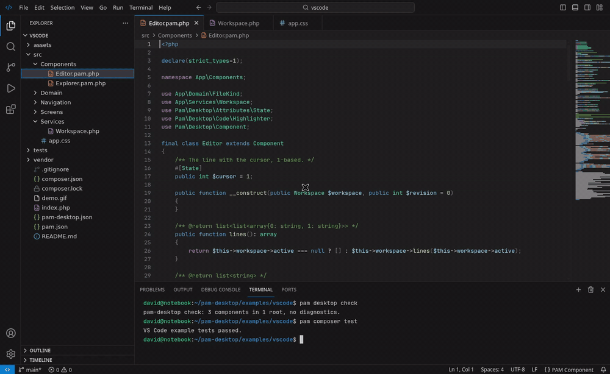

# Visual Studio Code

A VS Code workbench clone built only with PAM and PAM Desktop: no web view,
no JavaScript, every pixel a native view. It opens its own folder.



```bash
pam composer install
pam desktop dev
```

## What it shows

- **The workbench** in the Dark Modern theme: title bar with the command
  center, activity bar, side bar, editor, panel and status bar.
- **Explorer**: a DesktopUI `TreeView` of this project, each folder read from
  disk the first time it opens, folders first, file icons by type, indent
  guides on hover, VS Code's context menu with its shortcuts.
- **Layout**: `SplitView`s for the side bar and the panel, dragged or moved
  with the keyboard; Ctrl+B and Ctrl+` collapse them.
- **Editor**: a DesktopUI `CodeEditor` that really edits the file: several
  cursors (Ctrl+D, Alt+click), selections, undo, Tab/Shift+Tab, Ctrl+/,
  accents and input methods; tabs with an unsaved dot, breadcrumbs, a minimap,
  Ln/Col in the status bar, colours from `Pam\Desktop\Code`.
- **Activity bar**: rich tooltips with the shortcut, and the Manage menu as a
  `Popover`.
- **Quick Open**: Ctrl+P, letters in order (`wrkspc` finds `Workspace.php`),
  Enter opens the first.
- **Shortcuts**: Ctrl+P, Ctrl+B (side bar), Ctrl+` (panel), Ctrl+W, registered
  with `Shortcut::register`.

Icons are the Lucide set bundled with PAM Desktop (`font="Lucide"`); JetBrains
Mono (without ligatures, as VS Code ships) and Noto Sans, Latin subsets, are
packaged under `assets/fonts`.

## Layout

| Path | What goes there |
| --- | --- |
| `src/Screens/Workbench` | The window, the activity bar, the panel, the status bar, Quick Open and the shortcuts. |
| `src/Components` | `Explorer`, `Editor`. |
| `src/Services` | `Workspace` (tree, tabs, documents) and `Highlighter` (the colours). |
| `src/Domain` | Explorer entries and file kinds. |
| `tests/VsCodeTest.php` | `pam composer test`: colours, the tree, tabs, Quick Open and the mounted screen. |

| Task | Command |
| --- | --- |
| Check every template, stylesheet and route | `pam desktop check` |
| Run the tests | `pam composer test` |

JetBrains Mono and Noto Sans: SIL Open Font License (`assets/fonts/OFL-*.txt`).
